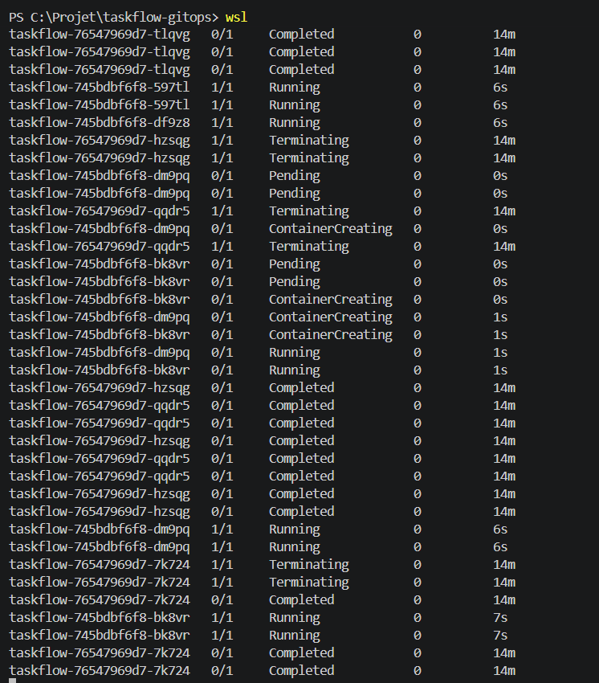

# taskflow-gitops — dépôt GitOps du cours CI/CD M2

Ce dépôt décrit **l'état voulu** de l'application TaskFlow dans Kubernetes.
Argo CD le surveille et aligne le cluster dessus : pour changer la production,
on ne tape pas de commande, on fait une **Pull Request**.

## Installation (à faire chez vous, avant le cours)

Prérequis : Docker Desktop démarré, 8 Go de RAM, 10 Go de disque libre.
Sous Windows : WSL2 (Ubuntu) + intégration WSL de Docker Desktop, et toutes les commandes dans WSL.

```bash
git clone https://github.com/9m7fjfpv9k-cyber/taskflow-gitops.git
cd taskflow-gitops
./scripts/install.sh
```

Le script crée un cluster local `kind`, installe Argo CD et Argo Rollouts,
puis télécharge les images des labs. Comptez 5 à 15 minutes.
Il peut être relancé sans risque.

## Structure

| Chemin | Rôle |
| --- | --- |
| `apps/taskflow/` | Les manifests surveillés par Argo CD |
| `argocd/application.yaml` | Déclare l'application dans Argo CD |
| `exemples/bluegreen/` | Manifests pour le déploiement Blue-Green |
| `exemples/canary/` | Manifests pour le déploiement Canary |
| `exemples/robustesse/` | Canary avec test de charge k6 automatique, modèle de postmortem |
| `exemples/ci/` | Pipelines de la mini-PSSI (GitHub Actions et GitLab CI) |
| `policies/` | Mini-PSSI et règles Rego vérifiées par conftest |
| `scripts/install.sh` | Installation de l'environnement |
| `scripts/argocd-ui.sh` | Ouvre l'interface d'Argo CD |
| `scripts/observe.sh` | Montre quelle version répond, et avec quel code HTTP |
| `scripts/charge.sh` | Lance à la main le test de charge k6 contre un service |

## Images disponibles

`ghcr.io/9m7fjfpv9k-cyber/taskflow` en versions `1.0.0`, `1.1.0`, `2.0.0`, `2.1.0` et `2.2.0`.

## Équipe

<!-- Noms du binôme -->
- Nicolas, Adam

## Livrable

Les déploiements sont déclenchés par les modifications du dépôt Git. 
Argo CD surveille le dépôt et synchronise l'état du cluster avec la configuration déclarée.
Chaque déploiement à une Pull Request (PR) sur main, ce qui permet de retrouver l'historique des changements.

### Push ou Pull ?

Nous utilisons une approche **Pull** : Argo CD récupère les modifications depuis le dépôt Git et les applique au cluster Kubernetes.
Contrairement à une approche Push, le pipeline CI ne déploie pas directement les ressources sur le cluster. Argo CD surveille le dépôt et assure la synchronisation.

### Qui a corrigé quoi ?

Les modifications sont traçables grâce à Git :

- Les commits identifient les auteurs et les changements.
- Les Pull Requests permettent de consulter les modifications proposées et les discussions.
- L'historique Git permet de retrouver les corrections et leurs motivations.

Cette traçabilité facilite la collaboration et l'identification des responsabilités.

### Pourquoi `git revert` ?

`git revert` permet d'annuler un changement en créant un nouveau commit qui inverse les modifications précédentes.

Dans notre cas, le bouton **Revert** de la Pull Request permet de revenir à la version `1.0.0` de l'image en annulant le changement vers `2.0.0`.

Cette méthode conserve l'historique Git et permet à Argo CD de détecter le changement, puis de redéployer la version précédente.

## LAB

1. Forker taskflow-gitops, inviter le binôme, ruleset sur main

2. argocd/application.yaml : votre pseudo, puis kubectl apply (chacun sur son cluster)

Argo en localhost

Mise a jour du repoURL dans application.yaml

Changement du contexte et apply de taskflow

3. Vérifier Synced + Healthy, puis ./scripts/observe.sh

Vérification Synced + Healthy sur le terminal

Vérification Synced + Healthy sur le dashboard

On observe bien la version 1.0.0 avec le script

4. PR : image 2.0.0. Mesurer le délai jusqu'au déploiement

Version 2.0.0 sur argo

Watch des pods pendant la merge

Watch pour voir combien de temps s'est écoulé apres la fin de la merge

5. Dérive : kubectl scale, kubectl set image. Que fait Argo CD ?

**Scale**

Commende pour scale 1 replicas

On observe que les 3 réplicas delete on été relancé automatiquement

**Set image**

Commande pour passer a la version 1.0.0

On observe une erreur

La version n'a pas changé

On peut conclure que Git reste la source de vérité. Les modifications manuelles du cluster ne remplacent pas la configuration déclarée dans le dépôt.

6. Bouton Revert sur la PR : retour en 1.0.0


Observe avant/apres le revert

Watch pendant le revert, les pods ont redémarré

On observe bien un revert de la version 2.0.0

Cette méthode conserve l'historique Git et permet à Argo CD de détecter le changement, puis de redéployer la version précédente.

7. Bonus : supprimer service.yaml par PR (prune)


Suppresion de `service.yaml` avec git rm


On observe que supprimer un fichier de configuration dans Git peut entraîner la suppression de la ressource correspondante dans Kubernetes
