# taskflow-gitops — dépôt GitOps du cours CI/CD M2

Ce dépôt décrit **l'état voulu** de l'application TaskFlow dans Kubernetes.
Argo CD le surveille et aligne le cluster dessus : pour changer la production,
on ne tape pas de commande, on fait une **Pull Request**.

## Installation (à faire chez vous, avant le cours)

Prérequis : Docker Desktop démarré, 8 Go de RAM, 10 Go de disque libre.
Sous Windows : WSL2 (Ubuntu) + intégration WSL de Docker Desktop, et toutes les commandes dans WSL.

```bash
git clone https://github.com/9m7fjfpv9k-cyber/taskflow-gitops.git
cd taskflow-gitops
./scripts/install.sh
```

Le script crée un cluster local `kind`, installe Argo CD et Argo Rollouts,
puis télécharge les images des labs. Comptez 5 à 15 minutes.
Il peut être relancé sans risque.

## Structure

| Chemin                    | Rôle                                                            |
| ------------------------- | --------------------------------------------------------------- |
| `apps/taskflow/`          | Les manifests surveillés par Argo CD                            |
| `argocd/application.yaml` | Déclare l'application dans Argo CD                              |
| `exemples/bluegreen/`     | Manifests pour le déploiement Blue-Green                        |
| `exemples/canary/`        | Manifests pour le déploiement Canary                            |
| `exemples/robustesse/`    | Canary avec test de charge k6 automatique, modèle de postmortem |
| `exemples/ci/`            | Pipelines de la mini-PSSI (GitHub Actions et GitLab CI)         |
| `policies/`               | Mini-PSSI et règles Rego vérifiées par conftest                 |
| `scripts/install.sh`      | Installation de l'environnement                                 |
| `scripts/argocd-ui.sh`    | Ouvre l'interface d'Argo CD                                     |
| `scripts/observe.sh`      | Montre quelle version répond, et avec quel code HTTP            |
| `scripts/charge.sh`       | Lance à la main le test de charge k6 contre un service          |

## Images disponibles

`ghcr.io/9m7fjfpv9k-cyber/taskflow` en versions `1.0.0`, `1.1.0`, `2.0.0`, `2.1.0` et `2.2.0`.

## Équipe

<!-- Noms du binôme -->

- Nicolas, Adam

## Livrable Lab 1

Les déploiements sont déclenchés par les modifications du dépôt Git.
Argo CD surveille le dépôt et synchronise l'état du cluster avec la configuration déclarée.
Chaque déploiement à une Pull Request (PR) sur main, ce qui permet de retrouver l'historique des changements.

### Push ou Pull ?

Nous utilisons une approche **Pull** : Argo CD récupère les modifications depuis le dépôt Git et les applique au cluster Kubernetes.
Contrairement à une approche Push, le pipeline CI ne déploie pas directement les ressources sur le cluster. Argo CD surveille le dépôt et assure la synchronisation.

### Qui a corrigé quoi ?

Les modifications sont traçables grâce à Git :

- Les commits identifient les auteurs et les changements.
- Les Pull Requests permettent de consulter les modifications proposées et les discussions.
- L'historique Git permet de retrouver les corrections et leurs motivations.

Cette traçabilité facilite la collaboration et l'identification des responsabilités.

### Pourquoi `git revert` ?

`git revert` permet d'annuler un changement en créant un nouveau commit qui inverse les modifications précédentes.

Dans notre cas, le bouton **Revert** de la Pull Request permet de revenir à la version `1.0.0` de l'image en annulant le changement vers `2.0.0`.

Cette méthode conserve l'historique Git et permet à Argo CD de détecter le changement, puis de redéployer la version précédente.

## LAB 1

1. Forker taskflow-gitops, inviter le binôme, ruleset sur main

2. argocd/application.yaml : votre pseudo, puis kubectl apply (chacun sur son cluster)

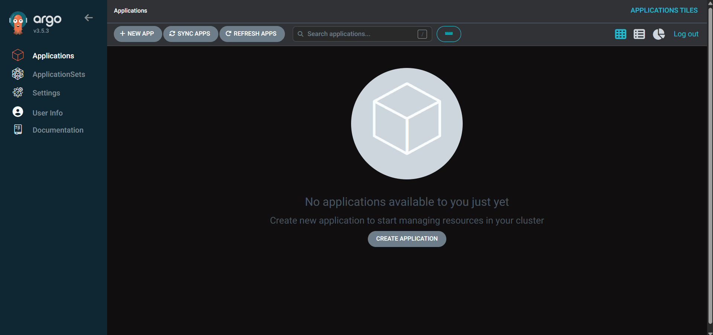

Argo en localhost
→ Argo CD est installé et accessible : c'est lui qui déploiera à notre place.

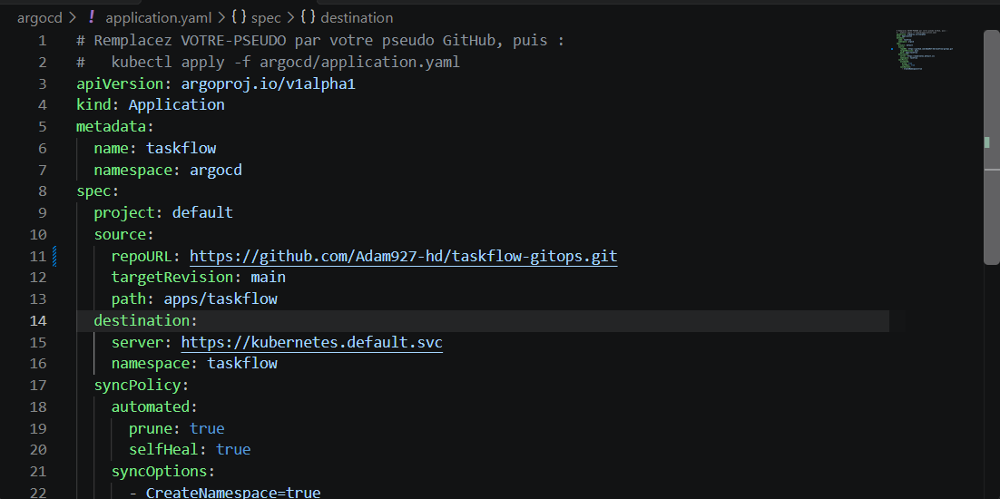

Mise a jour du repoURL dans application.yaml
→ Argo CD doit surveiller notre fork, pas le dépôt du formateur.

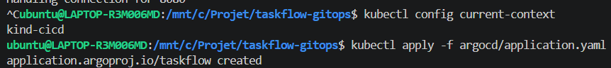

Changement du contexte et apply de taskflow
→ On cible `kind-cicd` pour ne pas déployer sur un autre cluster (AKS, k3d).

3. Vérifier Synced + Healthy, puis ./scripts/observe.sh

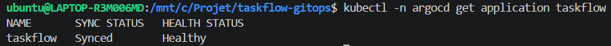

Vérification Synced + Healthy sur le terminal
→ Synced : le cluster correspond à Git. Healthy : les pods fonctionnent.

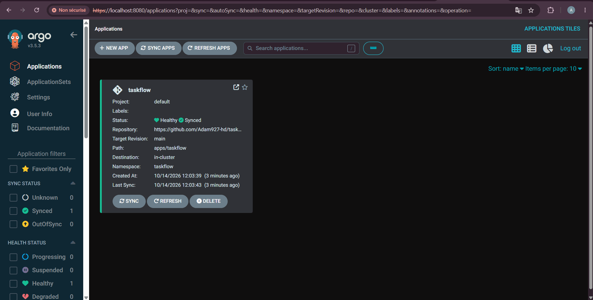

Vérification Synced + Healthy sur le dashboard

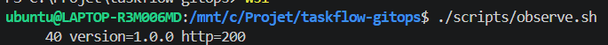

On observe bien la version 1.0.0 avec le script
→ 40 réponses http=200 : l'application répond réellement, pas seulement « Running ».

4. PR : image 2.0.0. Mesurer le délai jusqu'au déploiement

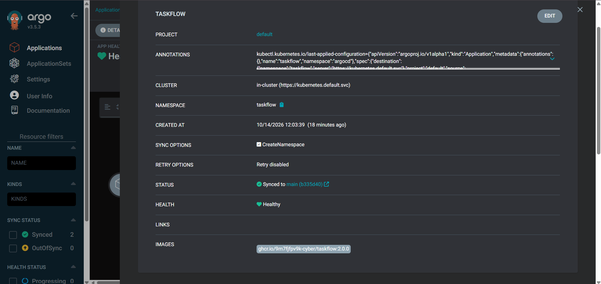

Version 2.0.0 sur argo
→ Le merge de la PR suffit : aucune commande de déploiement n'a été lancée.


Watch des pods pendant la merge
→ Les pods sont remplacés progressivement (rolling update), sans coupure.

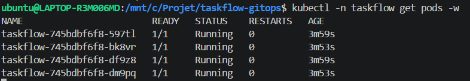

Watch pour voir combien de temps s'est écoulé apres la fin de la merge
→ Le délai vient du mode pull : Argo CD relit Git toutes les 60 s.

5. Dérive : kubectl scale, kubectl set image. Que fait Argo CD ?

**Scale**

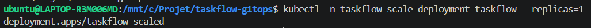

Commende pour scale 1 replicas
→ On crée volontairement une dérive : le cluster ne correspond plus à Git (4 réplicas).

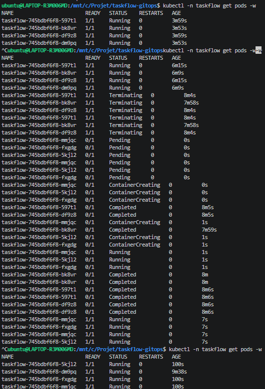

On observe que les 3 réplicas delete on été relancé automatiquement
→ `selfHeal: true` : Argo CD détecte l'écart et réapplique Git.

**Set image**

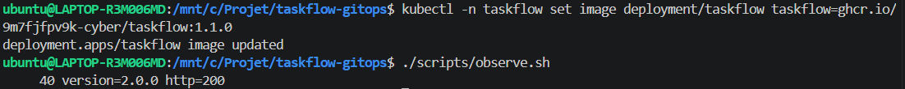

Commande pour passer a la version 1.0.0
→ Deuxième dérive : l'image du cluster diffère de celle déclarée dans Git.

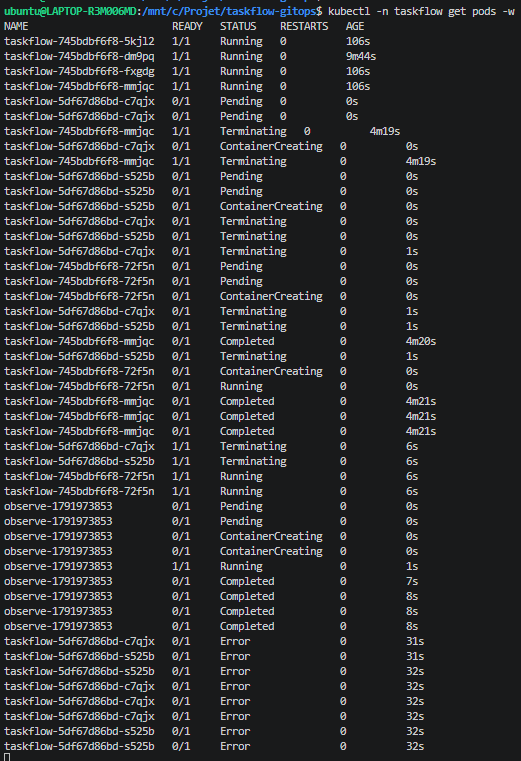

On observe une erreur
→ Argo CD annule la modification pendant qu'elle s'applique.


La version n'a pas changé
→ C'est toujours la version de Git qui tourne.

On peut conclure que Git reste la source de vérité. Les modifications manuelles du cluster ne remplacent pas la configuration déclarée dans le dépôt.

6. Bouton Revert sur la PR : retour en 1.0.0

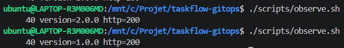

Observe avant/apres le revert
→ Le retour en 1.0.0 est confirmé par les réponses réelles du service.

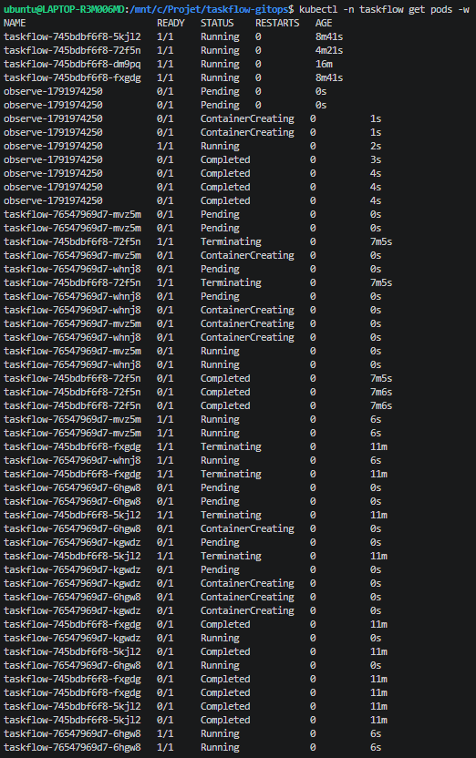

Watch pendant le revert, les pods ont redémarré
→ Le revert est un commit comme un autre : Argo CD le déploie automatiquement.

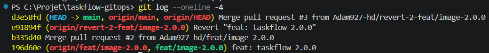

On observe bien un revert de la version 2.0.0
→ L'historique est conservé : on sait qui a déployé et qui est revenu en arrière.

Cette méthode conserve l'historique Git et permet à Argo CD de détecter le changement, puis de redéployer la version précédente.

7. Bonus : supprimer service.yaml par PR (prune)

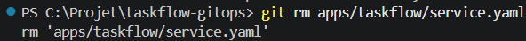
Suppresion de `service.yaml` avec git rm
→ La suppression passe par une PR, comme tout autre changement.

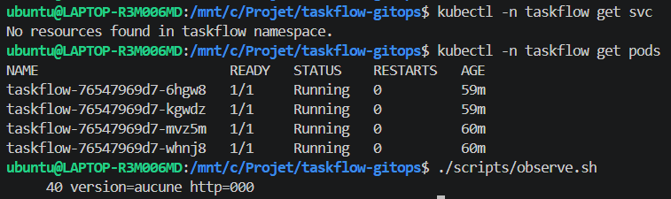
On observe que supprimer un fichier de configuration dans Git peut entraîner la suppression de la ressource correspondante dans Kubernetes
→ C'est l'effet de `prune: true`. Sans lui, le Service resterait dans le cluster, orphelin.

## Livrable 2

Canary pour TaskFlow.

Risque : avec la 2.1.0 défectueuse, Canary n'a exposé que 15 % du trafic (6 erreurs 500 sur 40), contre environ 60 % d'erreurs pour tous les utilisateurs avec Blue-Green. L'abort a rétabli la 2.0.0 instantanément.
Coût : Blue-Green double les pods (8 au lieu de 4) pendant la transition. Canary n'en ajoute presque pas, mais le déploiement est plus lent.

## LAB 2

### A • Blue-Green

1. Remplacer deployment.yaml par exemples/bluegreen/ (PR)


Ajout de la stratégie Bluegreen avec déploiement
→ Le Rollout remplace le Deployment : même template, seule la stratégie change.

2. PR: image 1.1.0

`image: ghcr.io/9m7fjfpv9k-cyber/taskflow:1.1.0`

3. observe.sh sur taskflow et taskflow-preview, compter les pods


Observe taskflow / Observe taskdlow-preview
On observe que la preview passe à la version 1.1.0
→ La production reste en 1.0.0 : on peut tester la 1.1.0 sans exposer les utilisateurs.


Les pods sont doublés
→ 8 pods au lieu de 4 : c'est le coût de Blue-Green pendant la transition.

4. promote, puis observe.sh


La bascule reste une décision humaine (`autoPromotionEnabled: false`).


Lorsque la commande promote a été lancé on observe que que taskflow passe aussi en 1.1.0
→ La bascule est totale et instantanée : 100 % du trafic change de version d'un coup.

### B • Canary

1. exemples/canary/rollout.yaml, image 1.1.0 (PR)


On change de stratégie en gardant l'image 1.1.0 déjà en production : aucune nouvelle version n'est déployée.

2. PR : image 2.0.0, suivre avec --watch et observe.sh


Dans le observe on voit que la version 2.0.0 a démarré
Dans le watch on observe que 25% (1 sur 4) du traffic est mise a jour
→ Sans maillage de service, la part de trafic suit la proportion de pods. Le rollout attend une promotion manuelle.

3. promote jusqu'à 100 %


50% (2 pods sur 4)


75% (3 pods sur 4)


100% (4 pods sur 4)
→ Après la première promotion, les paliers suivants s'enchaînent seuls (pauses de 60 s puis 30 s).

4. PR : image 2.1.O. Regardez les codes HTTP. Puis abort... et après ?


A l'ajoute de l'image 2.1.0 -> Status en pause + http=500
→ La 2.1.0 est défectueuse, mais seuls 25 % du trafic y sont exposés.


L'abort renvoie immédiatement tout le trafic vers la version stable 2.0.0.


Apres l'abort le status passe en dégradé
→ Et après ? Git demande toujours la 2.1.0 : il faut faire un revert de la PR pour que Git redevienne la source de vérité.
